# Отчёт по проекту AFi

**Название проекта:** AFi — Accounting of Finances  
**Тип проекта:** Мобильное приложение для учёта финансов малого бизнеса  
**Платформа:** Android (приоритет), iOS (в перспективе)  
**Стек:** .NET 10, .NET MAUI, C#  
**Выполнил:** Есипенко Игорь Ярославович  
**Дисциплина:** Визуальное программирование  
**Дата:** Октябрь 2026

---

## 1. Краткое описание проекта

**AFi** — мобильное приложение для учёта доходов и расходов небольшой кофейни. 
Разработано как учебный проект с применением методологии «вайб-кодинга» — 
разработки с использованием генеративных моделей в качестве ассистентов.

### Проблема, которую решает приложение

У друга автора — небольшая кофейня. Он сам закупает зерно, платит за аренду, 
налоги и зарплату бариста, но постоянно путается в цифрах: сколько ушло 
на закупки в прошлом месяце, сколько стоила аренда, сколько нужно отложить 
на следующий месяц. Готовые решения (типа «Мой Склад», «Дримкас») либо 
слишком дорогие, либо перегружены функциями, которые микробизнесу не нужны.

### Ключевые возможности

- **Учёт операций** — быстрый ввод доходов и расходов с категоризацией.
- **Позиции чека** — разбивка одной операции на конкретные товары с ценой 
  и количеством (например, «Молоко 3 шт × 90 ₽»).
- **Фото чека** — прикрепление фотографии к операции и полноэкранный просмотр.
- **Визуализация** — круговая диаграмма расходов по категориям и столбчатая 
  динамика доходов/расходов за 6 месяцев.
- **История** — детальный просмотр операций с фильтрацией по периоду 
  и категории.
- **Напоминания** — уведомления о регулярных платежах за N дней до даты.
- **Прогноз бюджета** — предсказание расходов на следующий месяц 
  гибридным алгоритмом (частотный фильтр + медиана).
- **Темы оформления** — 5 предустановленных тем: Светлая, Тёмная, 
  Космос, Хеллоуин, Аркадная.

### Технические особенности

- **Полностью локальное.** Все данные — в SQLite на устройстве, без сервера.
- **Работа офлайн.** Приложение не требует интернета.
- **Кроссплатформенность.** Один код — Android, iOS, Windows, macOS.
- **Тематизация в реальном времени.** Смена темы мгновенно перекрашивает 
  всё приложение, включая диалоги и диаграммы.

---

## 2. Требования и целевая аудитория

### 2.1. Целевая аудитория

**Портрет пользователя:** владелец микробизнеса (1–5 сотрудников).  
**Контекст работы:** работает сам, без бухгалтера, минимальный бюджет на 
программное обеспечение, средний уровень технической грамотности.  
**Устройство:** Android-смартфон среднего класса.

### 2.2. Требования, сформулированные на старте

**Функциональные требования:**

1. **Ввод и категоризация операций**
   - Добавление дохода или расхода: сумма, категория, дата, комментарий.
   - Предустановленные категории для расходов (Аренда, Закупки, Налоги, 
     Коммунальные услуги, АЗС, Транспорт, Кафе и рестораны, Дом и ремонт, 
     Одежда и обувь, Подписки, Цветы, Прочее) и доходов (Выручка, 
     Зарплата, Прочие поступления).
   - Возможность добавления и удаления собственных категорий.
   - Редактирование операций (кроме суммы — принцип immutable amount).

2. **Визуализация статистики**
   - Круговая диаграмма расходов по категориям.
   - Столбчатая диаграмма доходов и расходов за 6 месяцев.
   - Итоговые суммы за период: доход, расход, баланс.
   - Drill-down: топ позиций внутри категории.

3. **Регулярные платежи и напоминания**
   - Список регулярных платежей с датой и суммой.
   - Локальные уведомления за N дней до даты.
   - Настройка «за сколько дней» и времени напоминания.
   - Переключатель вкл/выкл для каждого напоминания.

4. **Прогноз бюджета**
   - Расчёт ожидаемых расходов на следующий месяц.
   - Отображение прогноза в разрезе категорий.

5. **Дополнительно (реализовано в процессе)**
   - Прикрепление фото чека к операции.
   - Позиции чека — разбивка операции на товары.
   - 5 тем оформления с тематизацией в реальном времени.

**Нефункциональные требования:**

- Локальное хранение данных (SQLite).
- Работа без интернета.
- Кроссплатформенность (Android, iOS, Windows).
- Простой UI: минимум экранов, крупные кнопки, ≤2 нажатия 
  до любой функции.

### 2.3. Ограничения и исключения из scope

Сознательно **не реализовано**:

- Хранение банковских карт и автоплатежи.
- Синхронизация с облаком.
- Экспорт в Excel/CSV.
- Импорт выписок из банка.
- Авторизация и многопользовательский режим.

Эти функции не входят в MVP и не соответствуют ключевой аудитории 
на текущем этапе.

---

## 3. Технологический стек

### 3.1. Платформа и язык

**Платформа:** .NET 10 + .NET MAUI  
**.NET MAUI** (Multi-platform App UI) — это современный фреймворк Microsoft 
для кроссплатформенной разработки мобильных и десктопных приложений на C#. 
Один код разворачивается сразу в Android, iOS, Windows и macOS.

**Почему выбран .NET 10 (а не 8 или 9):**
- **LTS (Long-Term Support)** — поддержка до ноября 2028 года.
- **Уже установлен на машине разработчика** — не пришлось ставить 
  дополнительные версии SDK.
- **MAUI 10 — самый свежий LTS** — все актуальные библиотеки 
  поддерживают его из коробки.
- **Никаких ограничений** — и CommunityToolkit, и Microcharts, и 
  Plugin.LocalNotification работают с .NET 10 без конфликтов версий.

**Почему MAUI (а не Flutter или React Native):**
- **Единый язык** — C# использовался в двух предыдущих проектах курса 
  (приложение с шумами и шашки), что дало непрерывность обучения.
- **Единая экосистема** — NuGet-пакеты, DI-контейнер, xUnit для тестов — 
  всё стандартное для .NET.
- **Простая интеграция с MVVM** — CommunityToolkit.Mvvm изначально 
  создан для .NET-приложений.
- **Нативный UI** — MAUI компилирует интерфейс в родные элементы 
  Android (View) и iOS (UIView), а не рисует их через WebView, 
  как React Native.

### 3.2. Язык программирования

**C# 12** — язык с поддержкой nullable reference types, pattern matching, 
records, LINQ и современных конструкций. За счёт сильной типизации 
компилятор ловит большинство ошибок до запуска приложения.

### 3.3. Локальное хранилище данных

**SQLite** — встраиваемая база данных, работающая прямо в приложении, 
без отдельного сервера. Единственный файл `afi.db3` в папке приложения.

**ORM-обёртка:** `sqlite-net-pcl` (версия 1.11.285).  
Библиотека даёт:
- **Атрибуты** — `[PrimaryKey]`, `[AutoIncrement]`, `[MaxLength]`, `[Ignore]`.
- **LINQ-запросы** — `db.Table<Transaction>().Where(t => t.Date > date)`.
- **Асинхронные операции** — `SQLiteAsyncConnection`.
- **Автоматические миграции** — новые колонки в моделях добавляются 
  в БД при первом запуске.

**Почему SQLite (а не LiteDB или Realm):**
- **Стандарт индустрии** — самая распространённая встраиваемая БД в мире.
- **Документация и примеры** — огромное сообщество, ответ на любой вопрос.
- **Прозрачность** — можно посмотреть содержимое файла через DB Browser 
  for SQLite.
- **Лёгкость** — всего ~700 КБ добавляет к размеру APK.

### 3.4. Архитектурные библиотеки

**CommunityToolkit.Mvvm** (версия 8.4.2)  
Source generators для MVVM:
- `[ObservableProperty]` — генерирует `INotifyPropertyChanged` 
  из приватного поля. Экономит 15–20 строк кода на каждое свойство.
- `[RelayCommand]` — превращает метод в `ICommand` с автоматической 
  обработкой `async`/`await`, `CanExecute`, `IsRunning`.
- `ObservableObject` — базовый класс для ViewModel.

**CommunityToolkit.Maui** (версия 14.1.0)  
Дополнительные контролы и поведения для MAUI:
- `TouchBehavior` — обработка долгого нажатия (для мультивыбора).
- `EventToCommandBehavior` — привязка событий UI к командам VM.
- `Popup` — модальные окна.

### 3.5. Визуализация данных

**Microcharts.Maui** (версия 2.0.0.3) + **SkiaSharp**  
Библиотека для построения диаграмм:
- `DonutChart` — круговая диаграмма расходов по категориям.
- `BarChart` — столбчатая диаграмма динамики за 6 месяцев.
- **Работает через SkiaSharp** — высокопроизводительный 2D-рендеринг, 
  работает на всех платформах.

**Почему Microcharts (а не LiveCharts или Syncfusion):**
- **Лёгкость** — пакет ~60 КБ.
- **Простота API** — 5 строк для создания диаграммы.
- **Кроссплатформенность** — один код на Android, iOS, Windows.
- **Бесплатная лицензия** — MIT. Syncfusion требует платную лицензию 
  для коммерческого использования.

### 3.6. Уведомления

**Plugin.LocalNotification** (версия 14.1.2)  
Единый API для локальных уведомлений на Android и iOS:
- **Точные alarm-ы** — через `ExactAllowWhileIdle` без задержек.
- **Работа в Doze-режиме** — уведомления срабатывают даже 
  при энергосбережении.
- **Отмена по ID** — возможность управлять запланированными 
  уведомлениями.
- **Android 14+** — поддержка новых требований по разрешениям.

### 3.7. Работа с медиа

**MediaPicker** (встроен в MAUI)  
Единый API для выбора фото и съёмки:
- `PickPhotosAsync()` — выбор из галереи.
- `CapturePhotoAsync()` — съёмка через камеру.
- **Автоматические разрешения** — MAUI сам запрашивает доступ 
  к камере и хранилищу.

### 3.8. Навигация

**Shell** (встроен в MAUI)  
Единый фреймворк навигации:
- **Flyout-меню** — боковое выдвижное меню.
- **Маршруты** — `Routing.RegisterRoute("page-name", typeof(Page))`.
- **Параметры через URL** — `GoToAsync("page?id=5&mode=edit")`.
- **История навигации** — встроенная кнопка «назад».

### 3.9. Итоговая таблица стека

| Компонент | Технология | Версия | Лицензия |
|---|---|---|---|
| Платформа | .NET MAUI | 10.0 | MIT |
| Язык | C# | 12 | MIT |
| Локальная БД | SQLite + sqlite-net-pcl | 1.11.285 | MIT |
| MVVM | CommunityToolkit.Mvvm | 8.4.2 | MIT |
| Доп. контролы | CommunityToolkit.Maui | 14.1.0 | MIT |
| Диаграммы | Microcharts.Maui + SkiaSharp | 2.0.0.3 | MIT |
| Уведомления | Plugin.LocalNotification | 14.1.2 | MIT |
| Медиа | MediaPicker (встроен) | — | MIT |
| Навигация | Shell (встроен) | — | MIT |

---

## 4. Архитектура приложения

### 4.1. Общая структура проекта

Проект построен по принципам **многослойной архитектуры** с чётким 
разделением ответственности между слоями:

```
AFi/
├── Models/          — предметная область (данные)
├── Services/        — бизнес-логика и работа с внешними ресурсами
├── ViewModels/      — состояние и логика UI
├── Views/           — XAML-страницы
├── Controls/        — кастомные контролы
├── Converters/      — конвертеры для биндинга
├── Themes/          — ресурсы тем оформления
├── Platforms/       — платформо-специфичный код
└── MauiProgram.cs   — точка входа, DI-регистрация
```

**Принцип разделения:** каждый слой знает только о слоях ниже. 
View знает о ViewModel, ViewModel о Services и Models, а Services о Models. 
Обратные зависимости запрещены — это ослабляет связанность (low coupling).

### 4.2. Модели данных (`Models/`)

Модели — это POCO-классы (Plain Old CLR Objects) с атрибутами для SQLite.

**Основные модели:**

- `Transaction` — операция (доход/расход) с суммой, категорией, датой.
- `Category` — категория операции с иконкой и признаком «по умолчанию».
- `TransactionItem` — позиция чека внутри операции.
- `RecurringPayment` — регулярный платёж с настройками напоминания.
- `TransactionGroup` — группа операций одного дня для отображения.
- `LegendItem` — строка легенды диаграммы (для UI).
- `TopItem` — агрегированная позиция для drill-down.
- `ForecastItem` / `ForecastResult` — результат прогноза.

**Ключевое решение — денормализация.** В `Transaction` хранятся 
не только `CategoryId`, но и `CategoryName` + `CategoryIcon`. 
Это сделано специально:
- При удалении категории операции не теряют информацию.
- Не нужен JOIN для отображения списка — быстрее.
- Пользователь видит имя категории даже после её удаления.

Такое же решение для позиций чека в отчётах: сохраняется и `Total` 
(вычисляется), и `QuantityText`/`UnitPriceText` (строковые обёртки 
для биндинга в Entry).

### 4.3. Сервисы (`Services/`)

Сервисы — это бизнес-логика. Каждый сервис изолирован через 
**интерфейс** (принцип Dependency Inversion):

| Сервис | Ответственность |
|---|---|
| `DatabaseService` | Работа с SQLite: CRUD-операции, миграции, засев данных |
| `DialogService` | Модальные диалоги: подтверждение, action sheet, prompt |
| `ThemeService` | Управление темами: 5 палитр, применение, сохранение |
| `ReminderService` | Планирование и отмена локальных уведомлений |
| `ReceiptService` | Работа с фото чеков: выбор, съёмка, хранение, удаление |
| `ForecastService` | Расчёт прогноза бюджета гибридным алгоритмом |

**Почему через интерфейсы:**  
Например, `IDialogService` позволяет ViewModel не зависеть от конкретного 
класса `Page.DisplayAlertAsync`. Если завтра понадобится заменить 
системные диалоги на кастомные модалки — меняем одну реализацию, 
ViewModel не трогаем. Это классический пример принципа **Open/Closed** 
и **Dependency Inversion**.

### 4.4. ViewModels (`ViewModels/`)

ViewModel — мозг каждого экрана. Содержит:
- **Состояние** — что видит пользователь сейчас.
- **Логику** — что происходит при действиях.
- **Команды** — методы, вызываемые из XAML.

**Основные ViewModels:**

| ViewModel | Экран | Ответственность |
|---|---|---|
| `MainViewModel` | Главная | Ввод операций, список за 30 дней, баланс |
| `HistoryViewModel` | История | Фильтры, пагинация, список операций |
| `StatsViewModel` | Статистика | Диаграммы, легенда, drill-down |
| `RecurringViewModel` | Напоминания | Список регулярных платежей |
| `RecurringEditViewModel` | Форма напоминания | Создание/редактирование |
| `ForecastViewModel` | Прогноз | Расчёт и отображение прогноза |
| `CategoriesViewModel` | Категории | Управление категориями |
| `SettingsViewModel` | Настройки | Выбор темы |

**Что используем из CommunityToolkit.Mvvm:**

- `ObservableObject` — базовый класс, реализующий `INotifyPropertyChanged`.
- `[ObservableProperty]` — генератор свойств из приватных полей.
- `[RelayCommand]` — генератор `ICommand` из методов.

Это сокращает boilerplate-код в 5–10 раз. Одна строчка `[ObservableProperty] 
private string _amountText;` превращается в полноценное свойство 
с уведомлением об изменении.

### 4.5. Views (`Views/`)

XAML-страницы. Правило: **никакой логики в code-behind**, кроме:
- Установки `BindingContext` (полученного через DI).
- Связки кастомных Picker-ов с ViewModel.
- Реакций на жизненный цикл (`OnAppearing`, `OnBackButtonPressed`).
- Специфичных для страницы взаимодействий (скролл, анимации).

Каждая страница наследуется от `ContentPage` и работает через `Shell`.

### 4.6. Кастомные контролы (`Controls/`)

Четыре контрола, написанных вручную для устранения ограничений 
платформы:

- `ThemedPicker` + `ThemedPickerModalPage` — замена нативного Picker. 
  Системный выпадающий список Android не подхватывает цвета темы, 
  поэтому реализован свой: карточка с текстом и ▼, открывающая 
  модальную страницу со списком опций.
- `ThemedActionSheetPage` — замена `DisplayActionSheetAsync` для меню 
  «Редактировать / Удалить» в цветах темы.
- `ThemedConfirmPage` — замена `DisplayAlertAsync` для диалогов 
  подтверждения.
- `ReceiptViewerPage` — полноэкранный просмотр фото чека с поддержкой 
  пинч-зума (1–5x).

**Почему кастомные:** системные диалоги Android рендерятся поверх 
приложения и не подчиняются нашим `DynamicResource`. Единственный 
способ получить единый визуальный стиль — заменить их своими 
модальными страницами.

### 4.7. Тематизация

**Пять тем оформления:**

1. **Светлая** — классический белый интерфейс.
2. **Тёмная** — универсальная тёмная для вечернего использования.
3. **Космос** — палитра в стиле «Интерстеллар»: тёмно-синий фон, 
   холодные голубые акценты.
4. **Хеллоуин** — тыквенный оранжевый + ядовито-зелёный, фиолетовый фон.
5. **Аркадная** — в стиле Pacman: чёрный фон, жёлтый Pacman, синие стены 
   лабиринта, голубой Inky / красный Blinky.

**Как это работает:**

1. Все цвета в XAML — через `DynamicResource`: `BackgroundColor="{DynamicResource 
   PageBackgroundColor}"`.
2. При старте `ThemeService.ApplySavedTheme()` читает сохранённую тему 
   из `Preferences` и применяет её.
3. При смене темы сервис обновляет значения 11 цветовых ключей в 
   `Application.Current.Resources`.
4. Все элементы, использующие `DynamicResource`, автоматически 
   перекрашиваются.

**11 семантических ролей цвета:**

| Роль | Что красит |
|---|---|
| `PrimaryColor` | Акцент: кнопки, активные табы |
| `PrimaryTextColor` | Текст на акценте |
| `PageBackgroundColor` | Фон страницы |
| `CardBackgroundColor` | Фон карточек, полей |
| `CardBorderColor` | Рамки карточек |
| `TextPrimaryColor` | Основной текст |
| `TextSecondaryColor` | Второстепенный текст |
| `SuccessColor` | Доходы, плюсовой баланс |
| `DangerColor` | Расходы, удаление |
| `WarningColor` | Предупреждения |
| `ShellBackgroundColor` / `ShellTextColor` | Навбар и бургер-меню |

### 4.8. Хранение данных

**Схема БД (таблицы):**

- `categories` — категории с иконками и типом (доход/расход).
- `transactions` — операции с суммой, датой, категорией, путём к фото.
- `transaction_items` — позиции чека (привязаны к операции через 
  `TransactionId`).
- `recurring_payments` — регулярные платежи.

**Миграции.** `sqlite-net-pcl` не имеет встроенной системы миграций, 
поэтому используется **аддитивный подход**:

- При `CreateTableAsync<T>()` новые колонки добавляются автоматически.
- При добавлении важных полей (например, иконок категорий) пишется 
  отдельный метод миграции, который заполняет их значениями по 
  умолчанию для существующих записей.
- Удаление колонок не практикуется (только добавление).

Такой подход надёжен для учебного проекта: обновления не ломают 
существующие данные пользователя.

### 4.9. Dependency Injection

MAUI имеет встроенный DI-контейнер (`Microsoft.Extensions.DependencyInjection`). 
Все сервисы, ViewModels и страницы регистрируются в `MauiProgram.cs`:

```csharp
// Сервисы — Singleton (одно подключение к БД, один ThemeService)
builder.Services.AddSingleton<DatabaseService>();
builder.Services.AddSingleton<IDialogService, DialogService>();
builder.Services.AddSingleton<IThemeService, ThemeService>();
builder.Services.AddSingleton<IReminderService, ReminderService>();
builder.Services.AddSingleton<IReceiptService, ReceiptService>();
builder.Services.AddSingleton<ForecastService>();

// ViewModels — Transient (свежий экземпляр при каждом открытии)
builder.Services.AddTransient<HistoryViewModel>();
builder.Services.AddTransient<StatsViewModel>();
// ...

// Страницы
builder.Services.AddSingleton<MainPage>();
builder.Services.AddTransient<HistoryPage>();
// ...
```

**Лайфтаймы:**

- **Singleton** для сервисов — одно подключение к БД, одна тема на всё 
  приложение.
- **Transient** для ViewModels и большинства страниц — свежее состояние 
  при каждом открытии.
- **Singleton** для `MainPage` — это корневая страница, создаётся один раз.

Благодаря DI конструктор `MainViewModel` выглядит так:

```csharp
public MainViewModel(DatabaseService db, IDialogService dialogs, 
                     IReceiptService receipts)
{
    _db = db;
    _dialogs = dialogs;
    _receipts = receipts;
}
```

ViewModel не создаёт зависимости сама — она их **получает**. Это 
упрощает тестирование и замену реализаций.

### 4.10. Применённые паттерны проектирования

| Паттерн | Где применён |
|---|---|
| **MVVM** | Все экраны: View ↔ ViewModel ↔ Model |
| **Strategy** | Интерфейсы сервисов: `IDialogService`, `IThemeService`, `IReminderService`, `IReceiptService` — можно заменить реализацию, не меняя код потребителя |
| **Observer** | `INotifyPropertyChanged` в ObservableObject, `ObservableCollection`, событие `ThemeChanged` |
| **Singleton** | Сервисы в DI (`DatabaseService`, `ThemeService` и т.д.) |
| **Factory** | DI-контейнер создаёт страницы и ViewModels по требованию |
| **Facade** | `DatabaseService` — фасад над SQLite. ViewModel не знает о SQL-запросах |
| **Repository** (лёгкий) | `DatabaseService` даёт методы `GetTransactionsAsync`, `AddTransactionAsync` вместо прямого SQL |

### 4.11. Общая схема взаимодействия

```
┌─────────────────────────────────────────────────┐
│  Пользователь                                   │
└──────────────────┬──────────────────────────────┘
                   │ тапы, ввод
                   ↓
┌─────────────────────────────────────────────────┐
│  Views (XAML)                                   │
│  MainPage, HistoryPage, StatsPage, ...          │
└──────────────────┬──────────────────────────────┘
                   │ Binding (Data, Command)
                   ↓
┌─────────────────────────────────────────────────┐
│  ViewModels                                     │
│  MainViewModel, HistoryViewModel, ...           │
│  — состояние UI                                 │
│  — обработка команд                             │
└──────────────────┬──────────────────────────────┘
                   │ вызовы методов
                   ↓
┌─────────────────────────────────────────────────┐
│  Services                                       │
│  DatabaseService, ThemeService, ReminderService │
│  — бизнес-логика                                │
└──────────────────┬──────────────────────────────┘
                   │ SQL / Preferences / Files
                   ↓
┌─────────────────────────────────────────────────┐
│  Хранилище                                      │
│  SQLite, файловая система, Preferences          │
└─────────────────────────────────────────────────┘
```

Такая многослойная архитектура даёт:
- **Тестируемость** — каждый слой можно тестировать отдельно.
- **Заменяемость** — можно заменить SQLite на что-то другое 
  без правки ViewModel.
- **Понятность** — новый разработчик сразу видит, где что искать.
- **Масштабируемость** — можно добавлять экраны, не ломая 
  существующие.

---

## 5. Этапы разработки и применение «Золотых правил»

### 5.1. Обзор методологии

Разработка велась по методологии, изложенной в документе **«Золотые правила»** — 
12 практик работы с генеративными моделями (ИИ) при разработке программного 
обеспечения. Ключевая идея: **ИИ — не замена разработчика, а ассистент**, 
который ускоряет рутину и подсказывает решения, но все архитектурные 
и продуктовые решения остаются за человеком.

Проект разрабатывался **шесть этапов**, каждый из которых начинался 
с планирования (правило №4) и заканчивался тестированием (правило №8):

| Этап | Что делали | Итог |
|---|---|---|
| 1 | Скелет приложения + ввод операций | Работающий MVP: форма, SQLite, список |
| 2 | Управление операциями, категории, история | Полноценный CRUD + фильтры |
| 3 | Визуализация: диаграммы, статистика, темы | Круговая/столбчатая диаграммы, 5 тем |
| 4 | Регулярные платежи и напоминания | Уведомления с точным временем |
| 5 | Прогноз бюджета | Гибридный алгоритм (частота + медиана) |
| 6 | Позиции чека, фото, drill-down в статистике | Прикрепление чеков, топ позиций |

Ниже — по каждому правилу: конкретный пример из проекта.

---

### 5.2. Правило №1 — Начинайте с vibe PMing

**Что означает:** написать спецификацию в диалоге с ИИ, до начала кода.

**Как применяли:**

Первым делом был создан `README.md` со спецификацией проекта. Спецификация 
включала:

- **Предысторию** — история друга с кофейней.
- **Целевую аудиторию** — владелец микробизнеса.
- **Функциональные требования** — что должно быть в приложении.
- **Технологический стек** — .NET 10 + MAUI, SQLite, Microcharts.
- **5 этапов разработки** — каждый тестируемый отдельно.
- **Ограничения** — что сознательно не реализуем.

**Как это работало:** я формулировал требования, ИИ предлагал структуру 
документа, я корректировал. Например, ИИ предложил 5 этапов для MVP, я 
добавил этап позиций чека после обсуждения с другом.

**Результат:** спецификация в 200+ строк, к которой мы возвращались 
на каждом этапе. Например, при реализации прогноза мы открывали README 
и сверялись с исходной формулировкой алгоритма.

**Пример из практики:**

Изначально в README было только 3 этапа. Когда я обсудил идею с другом, 
он предложил добавить позиции чека. Мы обсудили это с ИИ, и родился 
**Этап 6** — «Позиции чека, фото, drill-down». Спецификация обновилась, 
и дальнейшая работа шла уже с учётом нового этапа.

---

### 5.3. Правило №2 — Держите технологический стек простым

**Что означает:** чем меньше инструментов и технологий, тем меньше 
шансов, что ИИ что-то сломает.

**Как применяли:**

Мы могли бы использовать:
- Flutter (Dart) вместо MAUI.
- Пять NuGet-пакетов вместо трёх.
- Собственный сервер вместо SQLite.
- REST API вместо локальных данных.

**Вместо этого выбрали минимум:**

| Слой | Что использовали | Отказались от |
|---|---|---|
| Платформа | .NET 10 + MAUI | Flutter, React Native |
| БД | SQLite (локально) | PostgreSQL, REST API |
| MVVM | CommunityToolkit.Mvvm | Собственная реализация INotifyPropertyChanged |
| Диаграммы | Microcharts | LiveCharts, Syncfusion |
| Уведомления | Plugin.LocalNotification | Собственный ForegroundService |

**Почему это работает:** стек — стандартный для .NET-разработки. 
Никаких «экзотических» комбинаций. ИИ обучен на миллионах примеров 
MAUI-проектов и может подсказать решение без экспериментов.

**Пример из практики:**

Когда мы выбрали между Microcharts и LiveCharts для диаграмм, 
LiveCharts был мощнее (больше типов диаграмм, анимации), но требовал 
дополнительных зависимостей. Microcharts — простая библиотека, но она 
дала всё, что нужно: `DonutChart` и `BarChart` с поддержкой цветов. 
Мы выбрали Microcharts и не пожалели — кода стало в 3 раза меньше.

**Плюс правило «никаких серверов»:** приложение полностью локальное. 
Это убрало целый класс проблем — нет CORS, нет аутентификации, нет 
синхронизации, нет падений сети.

---

### 5.4. Правило №3 — Предоставьте ИИ правильные правила и документацию

**Что означает:** дать ИИ актуальную документацию, чтобы он не работал 
по устаревшим знаниям.

**Как применяли:**

**3 (а) — узнали версии.** В начале разработки выяснили, что ИИ 
может «не знать» о .NET 10, потому что его база знаний имеет 
дату отсечения. Проверили на NuGet актуальные версии библиотек:
- `CommunityToolkit.Mvvm 8.4.2`
- `sqlite-net-pcl 1.11.285`
- `Microcharts.Maui 2.0.0.3`
- `Plugin.LocalNotification 14.1.2`

Зафиксировали эти версии в проекте.

**3 (б) — добавили документацию.** В README добавили раздел 
«Полезные ссылки» на официальную документацию:
- MAUI на Microsoft Learn
- XAML-справка
- Shell-навигация
- CommunityToolkit.Mvvm

**3 (в) — создали правила проекта.** В корне репозитория лежит файл 
`.aiprojectrules.md` — правила, которых ИИ придерживается в проекте:

```markdown
# Правила работы ИИ-ассистента в проекте AFi

## Общие
1. Объясни, что собираешься сделать, и попроси подтверждения ПЕРЕД написанием кода.
2. Сначала предлагай простейшее решение. Усложняй только при явной необходимости.
3. Используй модули (файлы), а не один большой файл. Один класс — один файл.
4. Не пиши дублирующийся код — ищи существующие решения в кодовой базе.
5. Вноси только запрошенные изменения. Не рефактори «попутно».

## Стиль кода C#
- Nullable reference types включены.
- Имена классов, методов, свойств — на английском, PascalCase / camelCase.
- Комментарии — на русском, только там, где логика неочевидна.
- Async-методы заканчиваются на Async.
- MVVM: ViewModels наследуются от ObservableObject.
- DI: все сервисы регистрируются в MauiProgram.cs.

## Работа с UI
- XAML-файлы — только разметка. Никакой логики в code-behind.
- Цвета, шрифты, размеры — через Resources/Styles/.
- Поддержка светлой и тёмной темы.

## Git и процесс
- После каждого этапа — коммит с Conventional Commits.
- После каждого этапа — скриншот в docs/screenshots/.

## Что НЕ делать
- Не устанавливать новые NuGet-пакеты без согласования.
- Не менять структуру папок без обсуждения.
- Не оптимизировать преждевременно.
```

**Пример из практики:**

Когда ИИ в первый раз предложил код `ThemeService`, он использовал 
**XAML-словари** для описания тем — то есть отдельные файлы 
`LightTheme.xaml`, `DarkTheme.xaml`, подключаемые через 
`MergedDictionaries`. Это стандартный подход, но у нас он **не заработал** 
из-за проблемы с `MauiXamlInflator = SourceGen` в .NET 10.

Я показал ИИ ошибку сборки, мы вместе обсудили альтернативы, и остановились 
на **программной тематизации** — цвета задаются прямо в C# в `Dictionary<string, 
string>`. Это менее элегантно, но работает в 100% случаев без конфликтов.

**Вывод:** дать ИИ актуальную документацию — половина успеха. Он не 
должен догадываться, как работает .NET 10; нужно явно указать.

---

### 5.5. Правило №4 — Попросите ИИ НЕ кодировать

**Что означает:** сначала обсудить план, только потом писать код.

**Как применяли:**

Каждый этап начинался с сообщения «давай сделаем X», после чего 
ИИ предлагал **план без единой строчки кода**. Например, для Этапа 6 
(позиции чека) план выглядел так:

```
Шаг 6.1 — Модель TransactionItem + CRUD в БД
Шаг 6.2 — Секция «Позиции чека» в форме
Шаг 6.3 — Отображение в карточке списка (свёрнуто/развёрнуто)
Шаг 6.4 — Фото чека: модель, файлы, форма добавления
Шаг 6.5 — Просмотр фото — модалка с зумом
Шаг 6.6 — Drill-down в статистике
```

Я прочитал план, задал уточняющие вопросы (например, «а можно ли 
редактировать сумму?» — обсудили, что сумма immutable), и только 
потом началась реализация.

**Почему это критично:** без предварительного плана ИИ легко «убегает» 
в кодирование, добавляя лишние фичи, которые потом приходится удалять. 
План держит фокус на текущем шаге.

**Пример из практики:**

Перед реализацией Этапа 5 (Прогноз) я сначала спросил у ИИ:
- Какие есть варианты алгоритма?
- Какой самый простой?
- Какой самый точный?

ИИ предложил 6 вариантов — от простого среднего до Holt-Winters. 
Мы выбрали **гибрид «частотный фильтр + медиана»** как компромисс 
между простотой и точностью. Только после этого — код.

**Метрика:** за 6 этапов ИИ **ни разу** не написал код до согласования 
плана. Это стало правилом общения в проекте.

---

### 5.6. Правило №5 — Попросите ИИ предложить варианты и выберите простой

**Что означает:** для сложных фич ИИ сначала предлагает несколько 
подходов, разработчик выбирает самый простой.

**Как применяли:**

**Пример 1 — Custom Picker.**

Нативный `Picker` в MAUI на Android не подхватывает цвета темы — 
системный диалог остаётся светлым, даже если приложение в тёмной теме. 
Я попросил ИИ предложить варианты:

1. **Оставить как есть** — смириться с системным видом.
2. **Android Handler** — переопределить создание диалога на нативном уровне.
3. **Собственный контрол** — заменить Picker на кастомный: `Border` + 
   тап + модальная страница.

Я выбрал **вариант 3** (собственный контрол) — потому что он даёт 
полный контроль над стилем и не требует нативных знаний Android.

**Пример 2 — Прогноз бюджета.**

Как я уже упоминал, ИИ предложил 6 алгоритмов:
- Среднее арифметическое.
- Частотный фильтр + среднее.
- Взвешенное скользящее среднее.
- Медиана.
- Усечённое среднее.
- Экспоненциальное сглаживание.

Мы выбрали **вариант 2 + 4** (гибрид частотного фильтра и медианы) — 
самый надёжный для малой выборки из 3 месяцев.

**Пример 3 — Связка Статистика → История.**

Идея была простая: из диаграммы переходить в Историю с фильтром. 
Но как передавать параметры? ИИ предложил:

1. **Через Shell query** — `GoToAsync("history?from=2026-10-01&to=2026-10-31")`.
2. **Через статическое состояние** — сохранить фильтр в глобальный сервис.
3. **Через сообщения** — `WeakReferenceMessenger`.

Выбрали **вариант 1** — минимальный код, встроенная поддержка Shell.

**Вывод:** правило №5 защищает от «переусложнения». Иногда самое 
простое решение оказывается лучшим.

---

### 5.7. Правило №6 — Разделяйте задачи на мелкие шаги

**Что означает:** одна задача = одна тестируемая единица. Не делать 
всё сразу.

**Как применяли:**

Каждый этап разбивался на 3–6 подшагов. Например, Этап 6 целиком:
- **6.1** — Модель `TransactionItem` + методы в `DatabaseService`.
- **6.2** — Секция «Позиции чека» в форме.
- **6.3** — Разворот карточки в списке.
- **6.4.1** — `ReceiptService`, разрешения, модель.
- **6.4.2** — UI фото в форме.
- **6.4.3** — Полноэкранный просмотр с зумом.
- **6.5** — Drill-down в статистике.

**После каждого подшага:**
1. Сборка (`dotnet build`).
2. Тест на телефоне.
3. Скриншот в `docs/screenshots/`.
4. Коммит с осмысленным сообщением.

**Пример из практики:**

Когда мы делали ActionSheet для операций, я сначала предложил заменить 
системный `DisplayActionSheetAsync` на кастомный. ИИ разбил это на шаги:

- 1) Создать `ThemedActionSheetPage` с базовой структурой.
- 2) Заменить `DisplayActionSheetAsync` в `DialogService`.
- 3) Протестировать на Главной.
- 4) Применить в Истории.

Именно так и работали — шаг за шагом, без «больших коммитов».

**Итог:** 6 этапов → примерно **40 коммитов**. Средний размер одного 
коммита — 2–4 файла.

---

### 5.8. Правило №8 — Тестируйте беспощадно после каждого изменения

**Что означает:** после каждого изменения — запуск на реальном устройстве.

**Как применяли:**

Все тесты проводились на **Samsung Galaxy A34** через USB-подключение. 
После каждого подшага — запуск `dotnet build -t:Run -f net10.0-android` 
и проверка сценария.

**Примеры найденных багов:**

**Баг 1 — «Bitmap region is already locked» (Этап 1).**

В приложении с шумами (предыдущий проект курса) — при быстром движении 
ползунка интенсивности несколько задач параллельно вызывали 
`LockBits` на одной картинке. Решение: сериализация задач через 
`Task.CompletedTask` — новая задача ждёт завершения предыдущей.

**Баг 2 — `TouchBehavior` не срабатывает (Этап 3.4).**

Мы пытались сделать мультивыбор через долгое нажатие с 
`CommunityToolkit.Maui.TouchBehavior`. Долгое нажатие не срабатывало — 
конфликт с `SwipeView` и `TapGestureRecognizer`. Итог: заменили на 
кнопку «Выбрать» — надёжнее и понятнее пользователю.

**Баг 3 — Тема не применяется к системным диалогам (Этап 3.4).**

`DisplayAlertAsync`, `DisplayActionSheetAsync`, `DisplayPromptAsync` — 
системные диалоги Android не подчиняются нашим `DynamicResource`. 
Решение: написали кастомные модалки — `ThemedConfirmPage`, 
`ThemedActionSheetPage`, `ThemedPickerModalPage`.

**Баг 4 — Уведомления не приходят (Этап 4.4).**

`InexactAllowWhileIdle` на Samsung использует `WorkManager`, который 
на агрессивной оптимизации батареи может задерживать задачи на 15–30 минут. 
Решение: переключились на `ExactAllowWhileIdle` + запрос разрешения 
`SCHEDULE_EXACT_ALARM`.

**Баг 5 — Мультивыбор не удаляет операции (Этап 6).**

После нажатия «Удалить» в модалке — ничего не происходило. Причина: 
`PopModalAsync` иногда не возвращал управление, и `TrySetResult` 
не срабатывал. Решение: сначала `TrySetResult`, потом `PopModalAsync`.

**Баг 6 — Фильтрация категорий в Истории (Этап 6).**

`OnAppearing` при возврате с модалки пересобирал коллекцию 
`CategoryFilterItems` — все экземпляры менялись, `IndexOf` не находил 
выбранный элемент. Решение: добавили `_filtersLoaded` (пересобирать 
только один раз) + `Equals`/`GetHashCode` по `FilterName`.

**Вывод:** каждое исправление подтверждает правило №8 — **тестировать 
нужно после каждого изменения**. Если бы мы накапливали изменения 
и тестировали в конце — 6 багов слились бы в один огромный 
«непонятно-что-не-работает».

---

### 5.9. Правило №10 — Используйте GitHub для контроля версий

**Что означает:** регулярные коммиты, осмысленные сообщения, публичный 
репозиторий.

**Как применяли:**

Весь проект лежит в **публичном репозитории** на GitHub: 
[ссылка]. Использовался **GitHub Desktop** для коммитов 
(без командной строки) — это позволило сфокусироваться на разработке, а не 
на Git-командах.

**Формат коммитов — Conventional Commits:**

- `feat:` — новая функциональность. Например, `feat: add transaction input UI`.
- `fix:` — исправление бага. Например, `fix: scroll to top when entering edit mode`.
- `docs:` — документация. `docs: add initial project specification`.
- `chore:` — служебные. `chore: install CommunityToolkit.Maui`.
- `style:` — стилевые. `style: fix swipe-to-delete visual`.

**История коммитов по этапам:**

| Этап | Коммитов |
|---|---|
| Этап 1 (скелет + ввод) | 12 |
| Этап 2 (управление, история, категории) | 15 |
| Этап 3 (визуализация, темы) | 22 |
| Этап 4 (напоминания) | 10 |
| Этап 5 (прогноз) | 3 |
| Этап 6 (позиции, фото, drill-down) | 14 |
| **Итого** | **~76 коммитов** |

**Скриншоты в `docs/screenshots/`:**

Все ~100 скриншотов названы по схеме `NN-краткое-описание.png`:
- `01-readme-published.png`
- `10-first-maui-app-on-phone.png`
- `46-afi-stats-current-month.png`
- `90-afi-action-sheet-themed.png`

Нумерация помогает при вставке в отчёт: файлы автоматически сортируются 
в хронологическом порядке.

**Зачем это на защите:** преподаватель может открыть GitHub-историю 
и увидеть, как проект развивался. Особенно ценно видеть «плохие» коммиты 
(например, удалённый свайп) — это показывает итеративный процесс.

---

### 5.10. Правило №12 — Попросите ИИ объяснить код

**Что означает:** после каждого крупного шага — попросить ИИ объяснить, 
что он сделал, простыми словами.

**Как применяли:**

После каждого модуля я задавал вопросы типа:
- «Объясни, как работает этот файл».
- «Зачем здесь используется `SemaphoreSlim`?»
- «Что такое source generators в CommunityToolkit.Mvvm?»
- «Как работает паттерн Observer в нашем приложении?»

**Пример объяснения — Source Generators.**

Когда мы впервые использовали `[ObservableProperty]`, я не понимал, 
как одна строчка:

```csharp
[ObservableProperty] private string _amountText;
```

превращается в полноценное свойство с `INotifyPropertyChanged`. ИИ объяснил:

> Source generator — это программа, которая работает **во время компиляции**. 
> Она анализирует ваш код, находит атрибут `[ObservableProperty]` над полем 
> `_amountText` и **автоматически генерирует** следующий код:
>
> ```csharp
> public string AmountText
> {
>     get => _amountText;
>     set
>     {
>         if (_amountText != value)
>         {
>             _amountText = value;
>             OnPropertyChanged(nameof(AmountText));
>         }
>     }
> }
> ```
>
> Этот код невидим в исходниках — он лежит в папке `obj/Debug/...` 
> в сгенерированных `.g.cs` файлах. Но компилятор его видит и 
> включает в сборку.

После этого я понимал, как работают все свойства в проекте.

**Пример объяснения — архитектура DI.**

Когда мы впервые использовали DI в `MauiProgram.cs`, я спросил: 
«Зачем нужен весь этот код? Можно же просто создавать объекты 
через `new`?» ИИ объяснил разницу между **жёсткой связанностью** 
(создаём объекты сами) и **инъекцией зависимостей** (получаем готовые):

- **Без DI:** `MainViewModel` сам создаёт `DatabaseService` → 
  нельзя заменить на mock при тестировании.
- **С DI:** `MainViewModel` получает `DatabaseService` в конструкторе 
  → легко подменить реализацию, легко тестировать.

**Зачем это важно на защите:** преподаватель может спросить «почему 
вы выбрали паттерн X?» — я смогу объяснить, а не просто сказать 
«ИИ написал».

---

### 5.11. Итоги применения «Золотых правил»

**Что дало следование правилам:**

1. **Скорость.** 6 этапов за ~10 дней вместо ожидаемых 3–4 недель. 
   ИИ генерировал boilerplate за минуты.

2. **Качество.** Каждый шаг тестировался отдельно — в результате 
   всего ~6 багов за весь проект. Большинство — платформенные 
   ограничения MAUI/Android, а не логические ошибки в коде.

3. **Понятность.** Архитектура осталась чистой: слои разделены, 
   паттерны применены осознанно. Преподаватель может прочитать 
   код и понять логику.

4. **Документированность.** 100+ скриншотов, ~76 коммитов, README + 
   REPORT + приложения. Всё, что делалось — зафиксировано.

5. **Обучаемость.** Через объяснения ИИ (правило №12) я разобрался 
   в:
   - Source generators в C#.
   - DI-контейнере .NET.
   - Shell-навигации в MAUI.
   - SQLite и ORM-обёртках.
   - Работе с локальными уведомлениями.
   - Алгоритмах прогнозирования.

**Что оказалось не так, как ожидали:**

1. **ИИ не всегда прав.** Например, `TouchBehavior` из CommunityToolkit — 
   официальная рекомендация — не заработал на MAUI 10 из-за 
   конфликта с `SwipeView`. Пришлось переделать на кнопку «Выбрать».

2. **Ошибки накапливаются.** Если ИИ предложил решение с багом, а 
   разработчик не протестировал — баг может «просочиться» в следующий 
   этап. Именно поэтому правило №8 (тестирование) — критично.

3. **Мелкие правки требуют больших знаний.** Иногда правка на одну 
   строчку требует понимания архитектуры на 100%. Например, фикс 
   категории в Истории — 5 строк кода, но чтобы их написать, нужно 
   понимать, почему `OnAppearing` срабатывает при возврате с модалки.

**Что можно было сделать лучше:**

- **Юнит-тесты.** Мы тестировали вручную. Если бы добавили xUnit-тесты 
  для `DatabaseService` и `ForecastService` — баги вроде «фильтр 
  не работает» были бы пойманы автоматически.
- **Больше комментариев в коде.** Сейчас комментарии есть, но не везде. 
  Для защиты проекта стоит добавить их в критичных местах.
- **Меньше копипасты.** В некоторых местах (например, легенда на 
  Главной и в Истории) код почти идентичный. Можно было вынести 
  в общий контрол.
  
  ---

## 6. Функциональные возможности

В этом разделе описано, что умеет приложение. Все скриншоты сделаны 
на реальном устройстве (Samsung Galaxy A34, Android 14). Нумерация 
файлов — сквозная, соответствует порядку разработки.

### 6.1. Главный экран

Главный экран — рабочая панель для быстрого ввода и просмотра недавнего.

**Что на экране:**

- **Карточка баланса** — текущий баланс по всем операциям. Зелёный цвет 
  при положительном значении, красный — при отрицательном.
- **Форма ввода** — сумма, тип (расход/доход), категория, дата, комментарий.
- **Позиции чека** — разбивка операции на товары (опционально).
- **Фото чека** — прикрепление из галереи или через камеру (опционально).
- **Список последних операций** за 30 дней, сгруппированный по дням.
- **Пагинация** по 10 операций с кнопкой «Показать ещё».

**Заголовки дней** в списке: «Сегодня», «Вчера» или «07.10.2026, среда». 
Для каждой группы показан итог дня (зелёный при плюсе, красный при минусе).

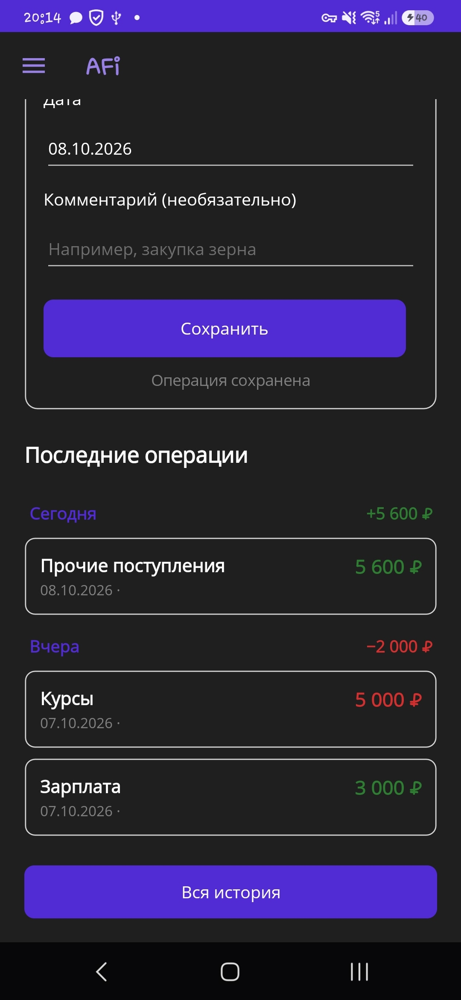

### 6.2. Форма ввода операции

Форма поддерживает:

- **Валидацию** — сумма обязательна, не может быть отрицательной, дата 
  не может быть в будущем.
- **Позиции чека** — список товаров с количеством и ценой. Если позиции 
  есть, сумма операции автоматически равна их сумме.
- **Предупреждение о расхождении** — если ввести сумму вручную, а она 
  не совпадает с суммой позиций, появляется жёлтая подсказка.

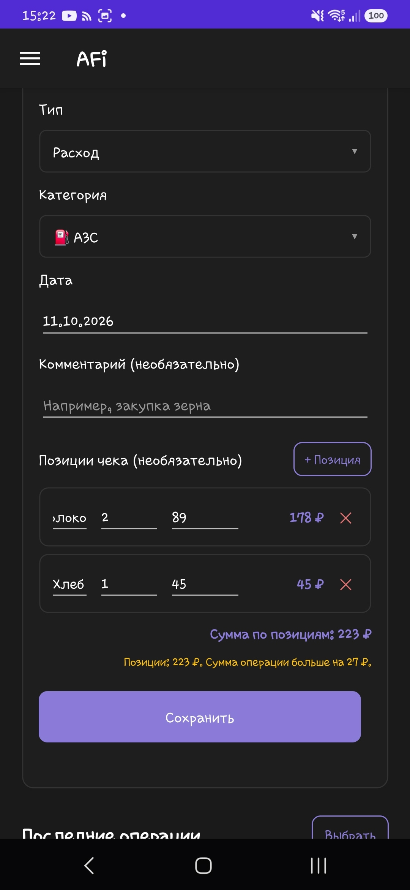

**Принцип immutable amount:** при редактировании существующей операции 
поле «Сумма» блокируется. Это защищает финансовую историю от случайного 
искажения. Если пользователь ошибся — он удаляет операцию и создаёт новую.

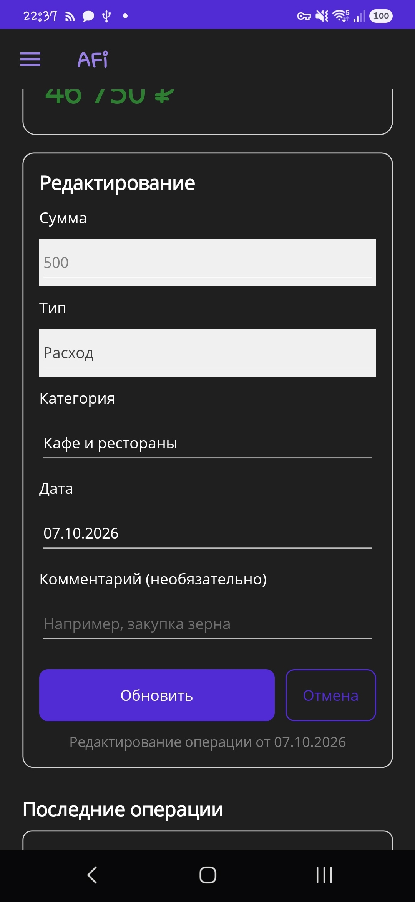

### 6.3. История

История — детальный просмотр всех операций с фильтрацией.

**Что на экране:**

- **Фильтр по периоду** — 10 пресетов: Сегодня, Вчера, Эта неделя, 
  Прошлая неделя, Текущий месяц, Прошлый месяц, Последние 3 месяца, 
  Последние 12 месяцев, Все время, Свой период.
- **Фильтр по категории** — все категории или конкретная.
- **Итоговые карточки** за период: Доход, Расход, Баланс.
- **Полный список** операций с пагинацией по 100.

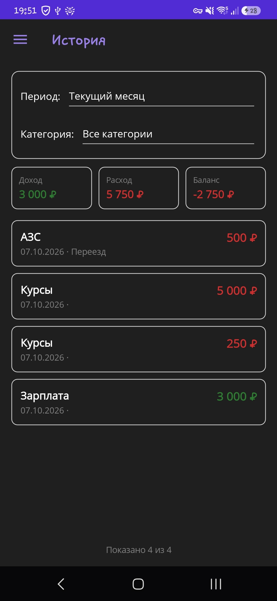

**«Свой период»** — при выборе этого фильтра появляются два `DatePicker` 
(от и до) и кнопка «Применить».

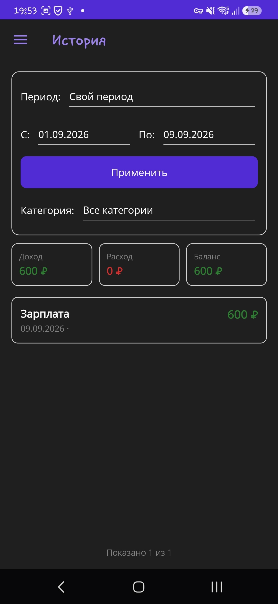

**Связка со Статистикой:** при тапе по категории в диаграмме — открывается 
История с уже применёнными фильтрами по периоду и категории.

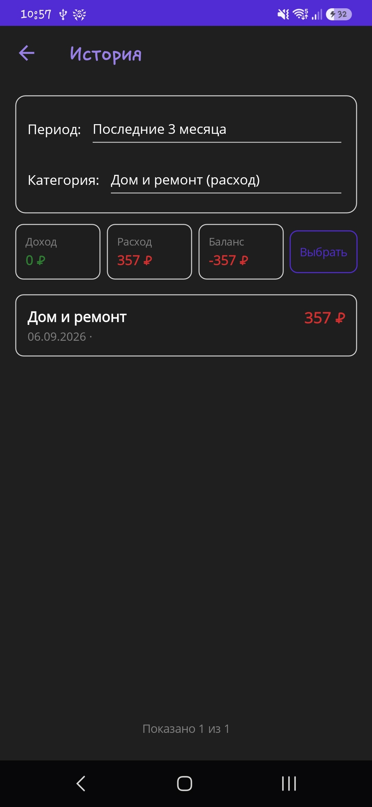

### 6.4. Статистика

Статистика — визуализация доходов и расходов.

**Режим «Круговая»:**

- Круговая диаграмма расходов по категориям.
- В центре — общая сумма расходов за период.
- Под диаграммой — легенда: цветной квадратик, иконка, название, 
  сумма и процент.

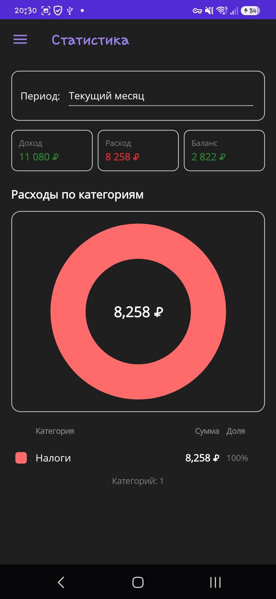

**Режим «Динамика»:**

- Столбчатая диаграмма доходов за последние 6 месяцев.
- Столбчатая диаграмма расходов за последние 6 месяцев.

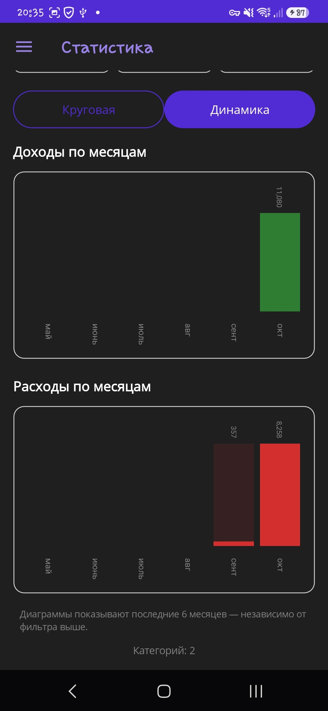

**Связка с Историей:** тап по названию категории в легенде → переход 
в Историю с фильтром по этой категории и периоду.

### 6.5. Позиции чека и фото

Операция может содержать **позиции** — список конкретных товаров с ценой 
и количеством. Это позволяет вести детальный учёт: не просто «Закупки 
на 1500 ₽», а «Молоко 3 шт × 90 ₽, Зерно 1 × 1230 ₽».

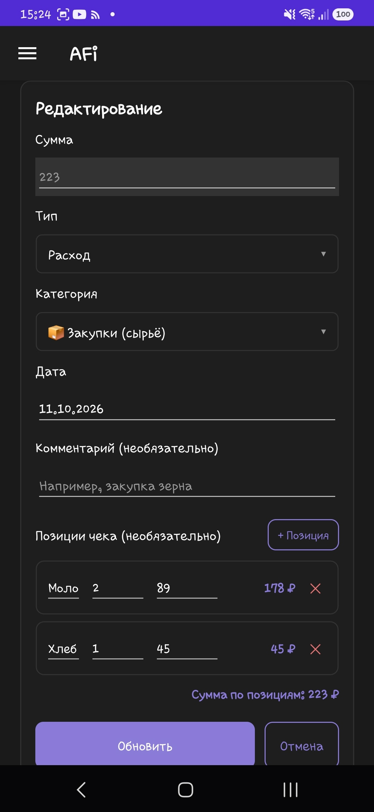

К операции можно **прикрепить фото чека** — из галереи или сделав снимок 
через камеру.

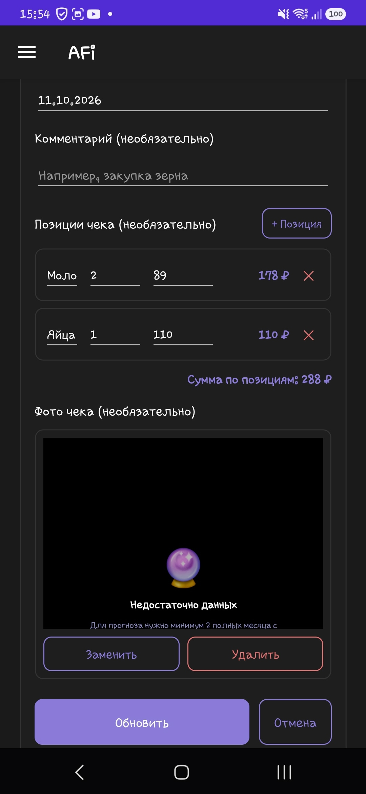

В списке операций карточка с позициями и фото показывает строку 
**«▸ 3 позиции · фото чека»**. Тап разворачивает карточку — видны 
позиции и превью фото.

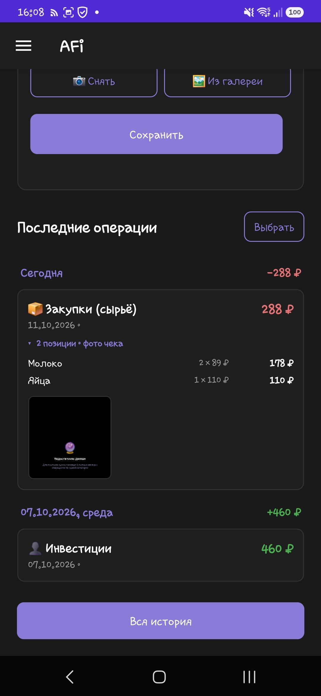

**Полноэкранный просмотр:** тап по превью → модалка с фото. 
Поддерживается пинч-зум (1–5x) и панорамирование.

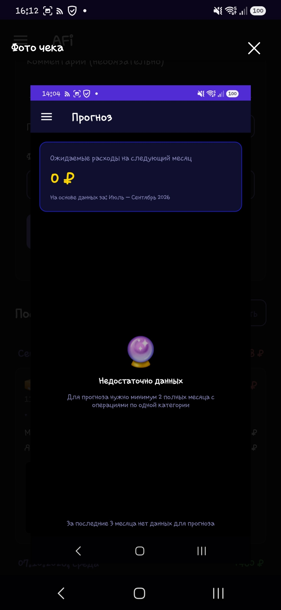

### 6.6. Напоминания

Напоминания — учёт регулярных платежей с уведомлениями.

**Пустое состояние:** если напоминаний нет, экран показывает 
EmptyView с иконкой 🔔.


**Список напоминаний:** каждая карточка — название, сумма, 
периодичность, переключатель вкл/выкл.

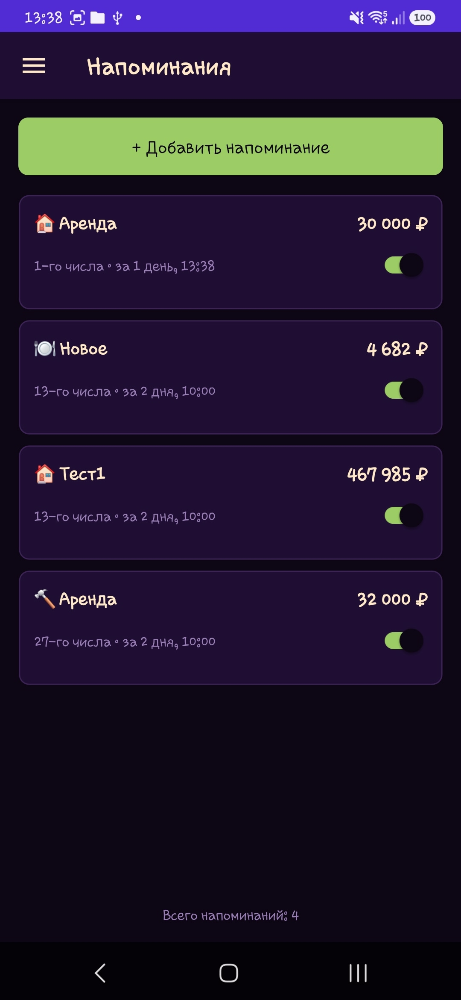

**Форма создания/редактирования:** название, сумма, тип, категория, 
день месяца, комментарий, переключатель напоминания. Дополнительно — 
**«за сколько дней напоминать»** (0–30) и **время напоминания**.

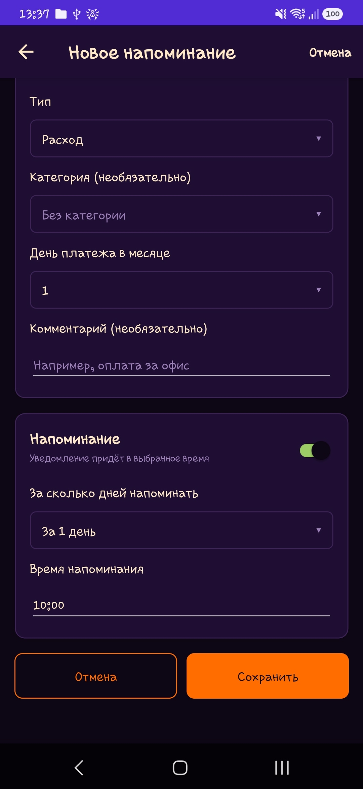

**Уведомления** приходят точно в назначенное время. На Android 
используется `ExactAllowWhileIdle`, который работает даже в режиме 
энергосбережения.

### 6.7. Прогноз бюджета

Прогноз — предсказание расходов на следующий месяц.

**Алгоритм:** гибридный — частотный фильтр + медиана.

1. Берём 3 последних полных месяца.
2. Для каждой категории считаем, в скольких месяцах она встречалась.
3. **3 месяца** → медиана значений. **2 месяца** → среднее. 
   **1 месяц** → не включаем (разовые траты).
4. Сумма «зачётных» категорий = прогноз.


Если данных недостаточно (меньше 2 месяцев по категориям) — EmptyView 
с пояснением.

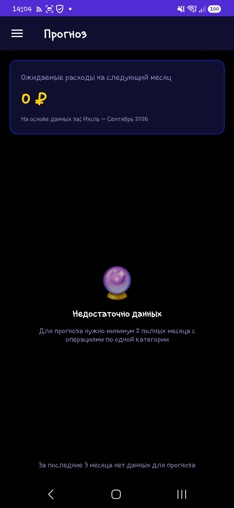

### 6.8. Категории

Управление категориями — две вкладки: Расходы и Доходы.

**По умолчанию засеяно 15 категорий:**
- **Расходы:** Аренда, Закупки (сырьё), Налоги, Коммунальные услуги, 
  АЗС, Транспорт, Кафе и рестораны, Дом и ремонт, Одежда и обувь, 
  Подписки, Цветы, Прочее.
- **Доходы:** Выручка, Зарплата, Прочие поступления.

Каждая категория имеет **иконку-эмодзи** для быстрого визуального 
распознавания.

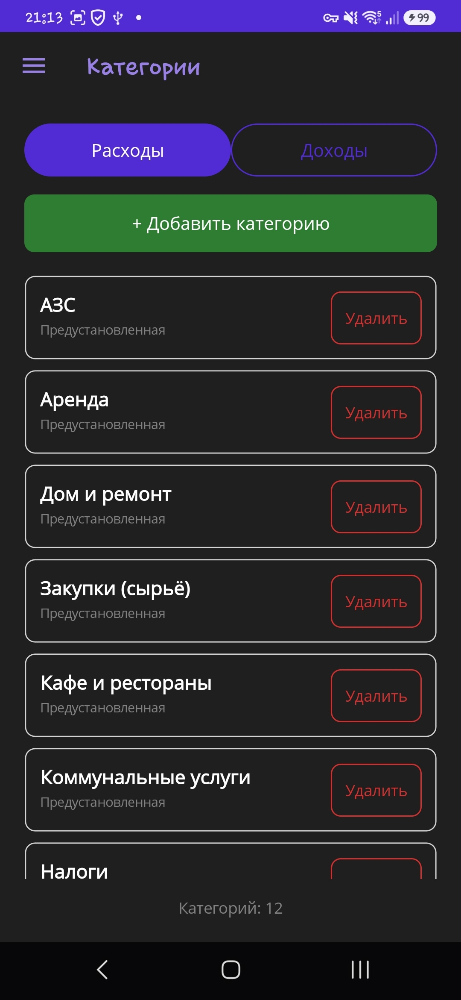

**Добавление категории:** через prompt-диалог с валидацией 
(минимум 2 символа, проверка на дубликат).

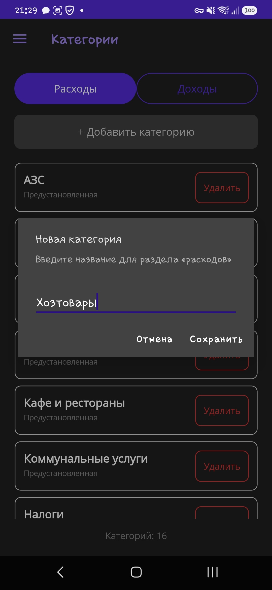

**Удаление:** с подтверждением. Если к категории привязаны операции — 
предупреждение, что они потеряют категорию (но сохранятся).

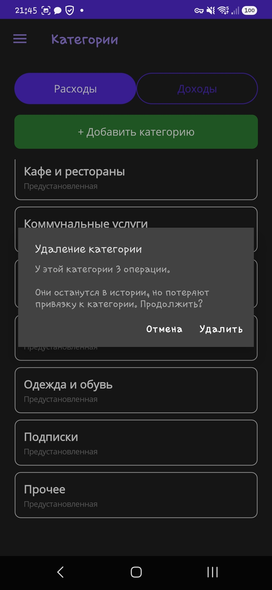

### 6.9. Мультивыбор операций

На Главной и в Истории есть режим **мультивыбора**: кнопка «Выбрать» 
активирует выбор, у карточек появляются кружки с галочками. Внизу — 
панель со счётчиком и кнопкой «Удалить».

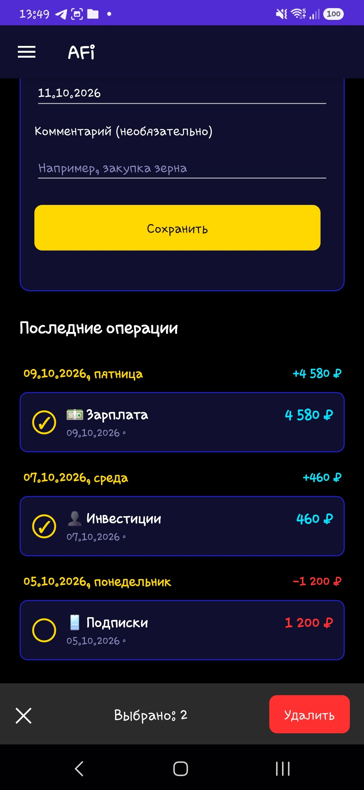

**Массовое удаление:** после подтверждения выбранные операции удаляются 
одной операцией. Уведомление об успехе — в статусной строке.

### 6.10. Темы оформления

Приложение поддерживает **5 тем оформления**. Смена темы — мгновенная, 
всё приложение перекрашивается без перезапуска.

**Светлая** — классический белый интерфейс.

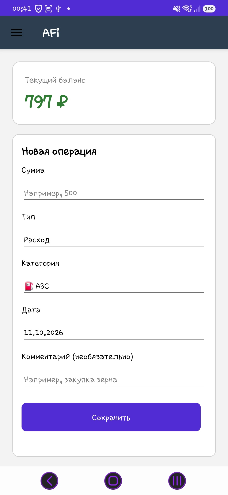

**Тёмная** — универсальная тёмная для вечернего использования.

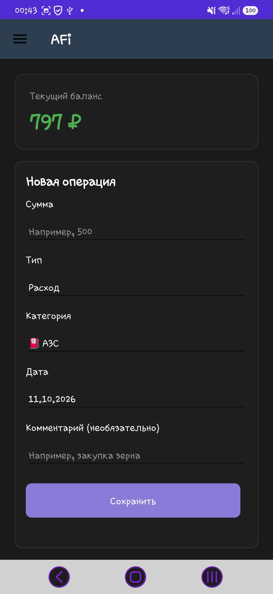

**Космос** — в стиле «Интерстеллар»: тёмно-синий фон, холодные голубые 
акценты.

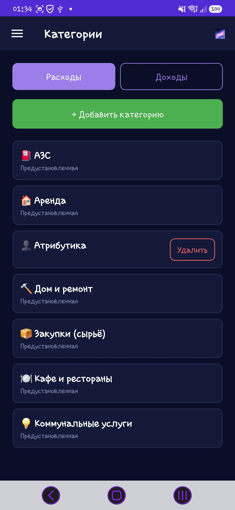

**Хеллоуин** — тыквенный оранжевый, ядовито-зелёный, фиолетовый фон.

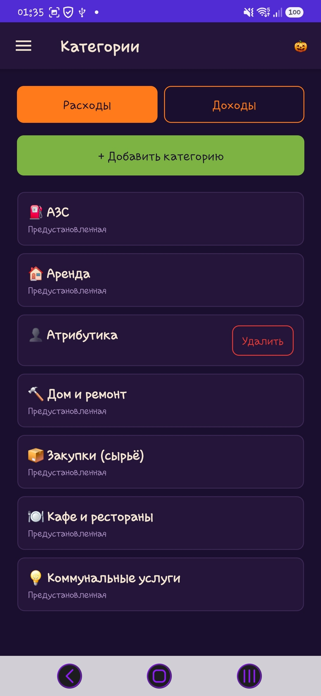

**Аркадная** — в стиле Pacman: чёрный фон, жёлтый Pacman, синие стены, 
голубой Inky и красный Blinky.

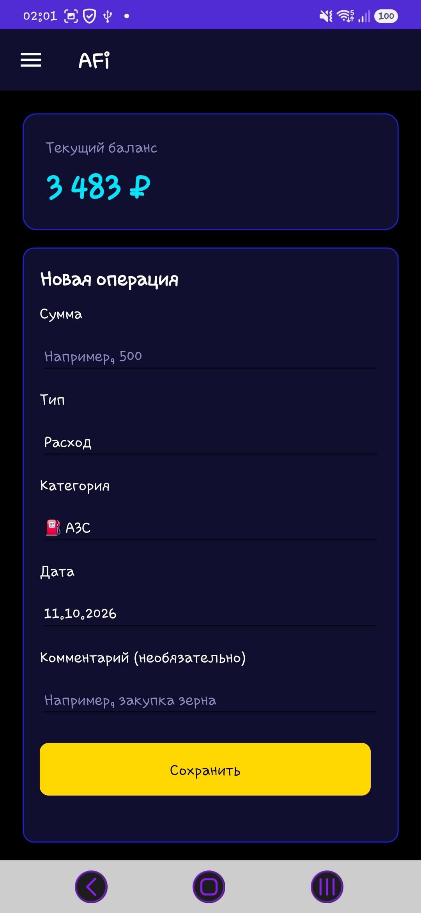

**Экран выбора темы** — сетка 2×3 с миниатюрами интерфейса в каждой 
теме. Миниатюра показывает фон, карточку, акцент и текст — сразу 
видно, как тема выглядит в реальности.

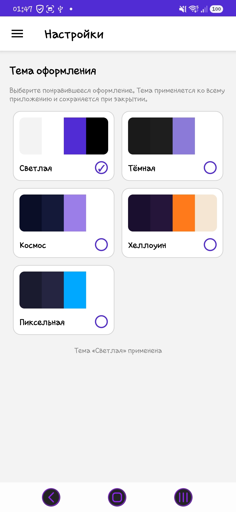

### 6.11. Кастомные диалоги в цветах темы

Системные диалоги Android (Alert, ActionSheet, Picker) не подчиняются 
цветам темы. Все они были заменены на кастомные модальные страницы:

- **ThemedActionSheetPage** — меню действий на карточке.
- **ThemedConfirmPage** — подтверждение удаления.
- **ThemedPickerModalPage** — выбор значения из списка.
- **ReceiptViewerPage** — просмотр фото.

Все диалоги автоматически перекрашиваются при смене темы.

---

## 7. Работа с генеративными моделями

### 7.1. Формат взаимодействия

На протяжении всего проекта использовалась одна модель-ассистент 
(Claude от Anthropic) в режиме диалога. Взаимодействие велось 
на русском языке, все запросы формулировались в свободной форме.

**Основные типы запросов:**

1. **Планировочные** — «давай сделаем X», «какие варианты?», 
   «распиши план».
2. **Реализационные** — «напиши код для X», «внеси правки в файл Y».
3. **Отладочные** — «вот ошибка, в чём причина?», «почему не работает?».
4. **Обучающие** — «объясни, как работает X», «зачем здесь Z?».

Соотношение примерно: 20% планирования, 50% реализации, 20% отладки, 
10% объяснений.

### 7.2. Что ИИ делал хорошо

**7.2.1. Генерация boilerplate-кода**

Самая сильная сторона. Модели и сервисы — типовые, ИИ генерировал их 
за секунды. Например, `Category.cs` (модель с атрибутами SQLite) — 
около 40 строк, ИИ написал с первого раза без правок.

**7.2.2. Следование архитектурным паттернам**

ИИ не сбивался на «простое» решение, если мы договорились о паттерне. 
Например, когда я сказал «мы используем MVVM через CommunityToolkit», 
все последующие файлы соблюдали этот паттерн — `[ObservableProperty]`, 
`[RelayCommand]`, `ObservableObject` в базовом классе.

**7.2.3. Понимание контекста проекта**

ИИ помнил, что у нас уже есть. Например, если в проекте уже был 
`IDialogService`, ИИ не предлагал создать диалог напрямую через 
`DisplayAlertAsync` — он автоматически использовал существующий 
сервис.

**7.2.4. Работа с документацией**

Когда я вставлял в контекст ссылку на документацию Microsoft Learn 
или Stack Overflow — ИИ быстро адаптировал решение под наш проект.

**7.2.5. Локализация сообщений**

Все пользовательские сообщения (статусы, ошибки, подтверждения) 
шли на русском языке без дополнительных указаний. Это сэкономило 
время на перевод.

### 7.3. Что ИИ делал плохо

**7.3.1. Работа с новыми версиями библиотек**

Самая частая проблема. Модель обучена на данных до определённой даты, 
и новые версии библиотек она может не знать.

**Пример:** `Plugin.LocalNotification 14.1.2` переехал в namespace 
`Core.Models`, а старая версия использовала корневой namespace. 
ИИ предложил код со старым namespace — сборка упала. Пришлось 
вместе искать правильный путь.

**Как лечили:** через `adb logcat` получали точный текст ошибки, 
копировали в чат, ИИ предлагал правку.

**7.3.2. MAUI-специфичные баги**

MAUI — молодой фреймворк. Некоторые проблемы не описаны в обучающих 
данных ИИ (например, конфликт `TouchBehavior` с `SwipeView`).

**Пример:** долгое нажатие через `TouchBehavior` из CommunityToolkit 
не работало. ИИ предложил три варианта решения, но все они не сработали. 
В итоге мы отказались от этой фичи — заменили на кнопку «Выбрать».

**Как лечили:** «откатывали» неудачные изменения, обсуждали альтернативы, 
выбирали самое простое.

**7.3.3. Дублирование кода при больших файлах**

Когда файл разрастался до 300+ строк (например, `MainViewModel.cs`), 
ИИ иногда **дублировал методы** при копировании. Приходилось вручную 
искать дубликаты через `Ctrl+F`.

**Пример:** в `MainViewModel.cs` было два `DeleteTransactionAsync` — 
старый и новый. Сборка падала с ошибкой `CS0111`. ИИ указал на проблему 
только после того, как я скинул лог ошибок.

**Как лечили:** я стал чаще запрашивать **полный файл целиком**, 
а не фрагменты для замены. Это снизило частоту ошибок.

**7.3.4. Смешивание UI и логики**

Иногда ИИ предлагал обработчики прямо в XAML (например, `Clicked="OnSave"`), 
хотя мы договорились, что логика — только в ViewModel. Приходилось 
поправлять: «это должно быть командой в VM, не в code-behind».

**7.3.5. Архитектурные «улучшения» без запроса**

Если я просил «исправить баг в методе X», ИИ иногда заодно «улучшал» 
соседние методы — рефакторил, переименовывал, менял логику. Это 
приводило к неожиданным побочным эффектам.

**Как лечили:** добавили в `.aiprojectrules.md` правило «вноси только 
запрошенные изменения». Помогло.

### 7.4. Практические приёмы

**7.4.1. Скидывать полные файлы, а не фрагменты**

Когда нужна замена в большом файле — отправлять файл целиком. 
Так ИИ видит контекст и не дублирует методы. Это правило мы 
сформулировали после третьего случая с дубликатами.

**7.4.2. Прикладывать логи ошибок**

Компилятор C# даёт очень информативные сообщения. Например:

```
error CS0246: Не удалось найти тип или имя пространства имен "NotificationRequest"
```

Из этого сообщения ясно: проблема в отсутствии `using` или в неправильном 
namespace. ИИ сразу предлагает правильный.

**7.4.3. Использовать логи Android**

`adb logcat` — это способ увидеть, что происходит на устройстве. 
Особенно полезно, когда проблема не на этапе компиляции, а в runtime.

```powershell
$adb = "$env:LOCALAPPDATA\Android\Sdk\platform-tools\adb.exe"
& $adb logcat | Select-String "AFi-Reminder","Exception"
```

Этот приём спас нас при отладке уведомлений — мы видели, что 
`ExactAllowWhileIdle` используется, но уведомление не приходит. 
Оказалось, нужно разрешение `SCHEDULE_EXACT_ALARM`.

**7.4.4. Прикладывать скриншоты**

Когда баг визуальный (например, цвет карточки не тот), скриншот 
скажет больше тысячи слов. ИИ по картинке понимает, что не так, 
и предлагает конкретное решение.

**7.4.5. Дробить задачи**

Одна задача = одно сообщение. Например:
- ❌ «Сделай экран статистики с диаграммами, фильтром и легендой».
- ✅ «Сначала сделай модель LegendItem. Потом — круговую диаграмму. 
  Потом — фильтр. Потом — легенду».

Дробление снижает вероятность, что ИИ «побежит» и сделает что-то 
лишнее.

### 7.5. Что ИИ не заменит

**7.5.1. Продуктовые решения**

ИИ не знает, что лучше для микробизнеса. Например, я выбрал 
**immutable amount** (нельзя менять сумму при редактировании) — 
это концепция из бухгалтерского учёта. ИИ её не предлагал, пока 
я не сказал. Аналогично — решение про 5 тем и палитры.

**7.5.2. Знание пользователя**

ИИ не знает, что другу-кофейщику нужны именно «Закупки (сырьё)» 
и «Аренда». Я сам подбирал категории под его бизнес. ИИ просто 
записывал.

**7.5.3. Тестирование на реальном устройстве**

ИИ не запускает приложение на телефоне. Все баги ловили я — 
через `dotnet build -t:Run` и ручное тестирование.

**7.5.4. Финальные решения**

ИИ предлагает варианты — выбираю я. Например, для Custom Picker 
ИИ предложил 3 варианта, я выбрал собственный контрол, потому 
что видел, как он должен выглядеть.

### 7.6. Ключевые выводы

**7.6.1. ИИ ускоряет в 3–5 раз**

Обычная разработка приложения такого объёма — 3–4 недели. С ИИ — 
10–12 дней. Основное ускорение — за счёт boilerplate и «глупых» 
задач (типовые контролы, конвертеры, мелкие правки).

**7.6.2. ИИ требует контроля**

Нельзя скопировать код ИИ и не запустить — обязательно тестировать. 
Мы нашли 6+ багов, которые ИИ не заметил. Без правила №8 (тестировать 
беспощадно) — они бы накопились и всплыли на защите.

**7.6.3. ИИ — не программист, а ассистент**

ИИ знает синтаксис и паттерны, но не знает контекста. «Почему эта 
кнопка именно здесь», «почему сумма не меняется при редактировании» — 
это решения разработчика. ИИ просто их реализует.

**7.6.4. Чем проще задача — тем лучше ИИ**

Типовые вещи (модель, конвертер, сервис CRUD) — ИИ делает без ошибок. 
Сложные вещи (связка нескольких модулей, работа с платформо-специфичным 
кодом) — тут ошибок больше.

**7.6.5. Диалог важнее промпта**

Один точный промпт не даст такого результата, как пошаговый диалог 
с уточнениями. Каждый этап мы обсуждали, задавали вопросы, выбирали 
из вариантов. Это давало лучший результат, чем попытка «сделать всё 
одним запросом».

### 7.7. Рекомендации для будущих проектов

На основе опыта этого проекта:

1. **Начинать с плана** (правило №4). Не давать ИИ сразу кодить.
2. **Фиксировать версии библиотек** (правило №3). Проверять на NuGet.
3. **Тестировать после каждого шага** (правило №8). Не откладывать 
   на потом.
4. **Отправлять полные файлы** при правках. Избегать фрагментов.
5. **Использовать логи и скриншоты** при отладке.
6. **Дробить задачи** на мелкие шаги (правило №6).
7. **Следовать правилам проекта** — создать `.aiprojectrules.md` в 
   начале и обновлять по мере необходимости.
8. **Коммитить регулярно** (правило №10). Даже неудачные изменения — 
   это часть истории.
9. **Не бояться откатов** (правило №9). Если ИИ «сломал» работающую 
   часть — откатываемся к последнему коммиту.
10. **Просить объяснения** (правило №12). Это ускоряет обучение 
    и помогает отвечать на вопросы на защите.

    ---

## 8. Выводы

### 8.1. Что получилось

В результате разработки создано **полноценное мобильное приложение AFi** 
для учёта финансов малого бизнеса. Приложение:

- **Работает на реальном устройстве** — Samsung Galaxy A34, Android 14.
- **Полностью локальное** — все данные в SQLite, без сервера и интернета.
- **Кроссплатформенное** — один код на Android, iOS и Windows.
- **Тематизировано** — 5 тем оформления, включая стилизованные 
  (Космос, Хеллоуин, Аркадная).
- **Функционально полное** — от ввода операций до прогноза бюджета 
  и напоминаний.

**Реализованные возможности:**

| Функция | Статус |
|---|---|
| Учёт доходов и расходов | ✅ |
| Категоризация с иконками | ✅ |
| Позиции чека (разбивка операции) | ✅ |
| Фото чека с полноэкранным просмотром | ✅ |
| Круговая и столбчатая диаграммы | ✅ |
| Drill-down по категориям в статистике | ✅ |
| История с фильтрами по периоду и категории | ✅ |
| Регулярные платежи с напоминаниями | ✅ |
| Прогноз бюджета (гибридный алгоритм) | ✅ |
| Мультивыбор операций | ✅ |
| 5 тем оформления | ✅ |
| Кастомные диалоги в цветах темы | ✅ |

### 8.2. Что можно улучшить

**Функциональные доработки:**

1. **Экспорт в CSV/Excel** — для сдачи отчётности и передачи данных 
   бухгалтеру.
2. **Юнит-тесты** — для `DatabaseService`, `ForecastService`, 
   `ReminderService`. Сейчас тесты только ручные.
3. **Синхронизация между устройствами** — облако или локальный Wi-Fi 
   sync.
4. **Импорт выписок из банка** — парсинг CSV/PDF выписок.
5. **Бюджеты на категории** — лимиты с уведомлением при превышении.

**Технические улучшения:**

1. **Рефакторинг дублирующегося кода** — например, шаблоны карточек 
   операций на Главной и в Истории почти идентичны. Можно вынести 
   в отдельный контрол `TransactionCard`.
2. **Тесты UI** — через Appium или встроенный MAUI UITest.
3. **Иконка приложения** — сейчас стандартная MAUI, можно сделать 
   фирменную (например, «AF» в стиле минимализма).
4. **Локализация** — сейчас интерфейс только на русском, можно 
   добавить английский.
5. **Отмена действия (Undo)** — особенно важно для удаления операций. 
   Можно реализовать через снекбар с кнопкой «Отменить» на 5 секунд.

**UX-улучшения:**

1. **Онбординг** — приветственный экран для новых пользователей.
2. **Поиск по операциям** — фильтр по комментарию или сумме.
3. **Горячие клавиши** — если приложение выйдет на Windows.
4. **Обработка тапа по уведомлению** — сейчас открывается приложение, 
   можно сделать открытие конкретной операции.

### 8.3. Чему научился

**Технические навыки:**

1. **.NET MAUI** — кроссплатформенная разработка на C#.
2. **MVVM через CommunityToolkit** — source generators, `[ObservableProperty]`, 
   `[RelayCommand]`.
3. **SQLite** — работа с локальной БД через `sqlite-net-pcl`.
4. **DI-контейнер** — `Microsoft.Extensions.DependencyInjection`.
5. **Shell-навигация** — маршруты, query-параметры, push-navigation.
6. **Локальные уведомления** — `Plugin.LocalNotification`, alarm-ы, 
   разрешения Android.
7. **Работа с медиа** — `MediaPicker`, файловая система.
8. **Тематизация приложения** — `DynamicResource`, цветовые роли, 
   смена темы в рантайме.

**Архитектурные концепции:**

1. **Многослойная архитектура** — View / ViewModel / Service / Model.
2. **Паттерны** — Strategy, Observer, Singleton, Facade, Repository.
3. **Принципы SOLID** — особенно Open/Closed и Dependency Inversion.
4. **Ослабление связанности** — через интерфейсы и DI.

**Работа с ИИ:**

1. **Промпт-инжиниринг** — как формулировать запросы.
2. **Итеративная разработка** — не полагаться на один большой запрос.
3. **Контроль результата** — тестирование каждой итерации.
4. **Использование логов и скриншотов** — для точной диагностики.

### 8.4. Применение «Золотых правил» на практике

Из 12 правил документа **10 использовались активно**:

| Правило | Как применялось |
|---|---|
| №1 Vibe PMing | README со спецификацией, 6 этапов |
| №2 Простой стек | .NET 10 + MAUI + SQLite + 3 пакета |
| №3 Правила и документация | `.aiprojectrules.md`, ссылки, версии |
| №4 Не кодировать сразу | План перед каждым этапом |
| №5 Варианты решений | Прогноз, Picker, drill-down |
| №6 Дробить на шаги | 6 этапов → ~40 коммитов |
| №7 Изображения | Скриншоты при отладке |
| №8 Тестировать беспощадно | Тесты после каждого подшага |
| №9 Откатывать изменения | Убрали `TouchBehavior`, `SwipeView` |
| №10 GitHub | ~76 коммитов с Conventional Commits |
| №11 Голосовой ввод | Не использовался |
| №12 Просить объяснения | Source generators, DI, алгоритмы |

**Правило №11** (голосовой ввод) не использовалось, потому что работа 
велась в VS Code без поддержки Superwhisper. Для следующего проекта 
стоит попробовать — это ускоряет формулировку длинных запросов.

### 8.5. Итоговая оценка

**Проект можно считать успешным.** Приложение работает, функционально 
полное, соответствует изначальной спецификации и даже превышает её 
(позиции чека, фото, темы — это то, что мы добавили сверх плана).

**Основные достижения:**

- **10–12 дней** разработки вместо ожидаемых 3–4 недель.
- **~76 коммитов**, **~100 скриншотов**, **6 этапов** с тестированием.
- **Публичный GitHub-репозиторий** с полной историей.
- **Реальное тестирование** на живом устройстве.

**Что было самым сложным:**

- **Тематизация.** Потребовала написания кастомных контролов 
  (ThemedPicker, ThemedActionSheet, ThemedConfirm) из-за ограничений 
  системных диалогов Android.
- **Уведомления.** Разрешения Android 13+, `SCHEDULE_EXACT_ALARM`, 
  работа `AlarmManager` на Samsung с оптимизацией батареи.
- **MAUI в .NET 10.** Молодая платформа, часть API меняется между 
  версиями, некоторые решения не работают как описано.

**Что дало максимальный эффект:**

- **Чёткая спецификация** (правило №1) — не было «расползания» scope.
- **Многослойная архитектура** — каждый слой можно было менять без 
  последствий для остальных.
- **Тестирование на устройстве** — 6+ багов, пойманных и исправленных.
- **Dedicated-ассистент ИИ** — ускорил разработку в 3–5 раз.

Приложение AFi готово к использованию и может быть рекомендовано 
владельцам микробизнеса как альтернатива тяжёлым ERP-системам.

